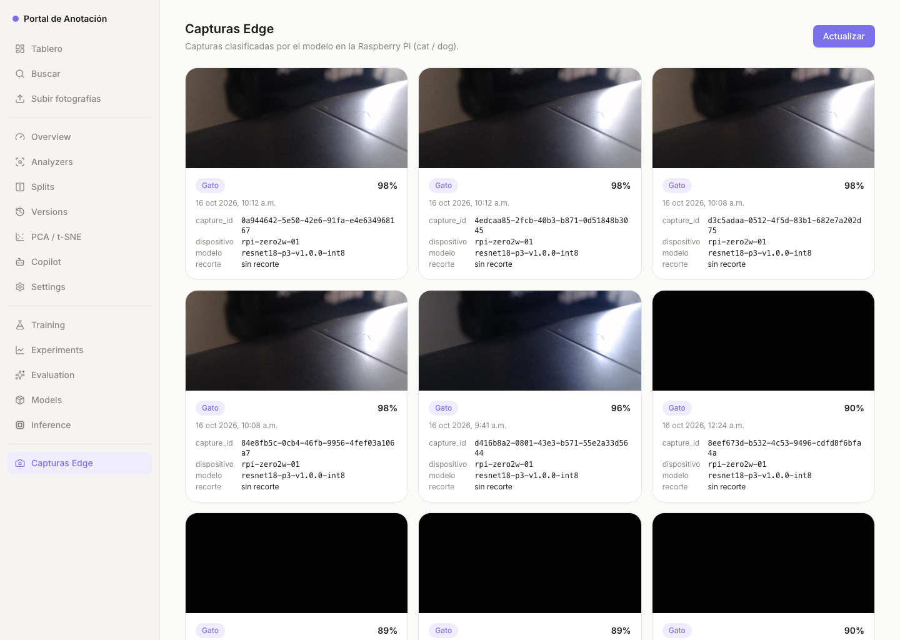

# P4-15 — «Capturas Edge» conectada a la API de lectura real

**Issue:** [#15](https://github.com/sanchezesteban/MLOPS_p4/issues/15) · **Responsable:** Uriel (@urielpinag)
**Ámbito:** rúbrica 5.2, compuerta **M3**.

## Cómo quedó conectada

La sección «Capturas Edge» (PR #38) ya leía la URL desde `VITE_CAPTURES_API_URL`; el despliegue de AWS (infra #18, PR #36/#44) compila el frontend con:

```text
VITE_CAPTURES_API_URL = https://el1c2mr69k.execute-api.us-east-2.amazonaws.com
```

Ese valor queda inlinado en el bundle desplegado (`grep` del `index-*.js` lo confirma, y **no** contiene `sample.json`: en producción nunca hay datos de ejemplo). El CORS de `GET /captures` incluye el origen del portal (`http://3.133.248.228`).

## Verificación contra AWS (16 oct 2026)

La captura más reciente al momento de la evidencia, **`0a944642-5e50-42e6-91fa-e4e634968167`**, coincide en las tres vistas: lo que muestra el portal, lo que responde `GET /captures` y el ítem en DynamoDB (`GetItem` directo):

| Campo | Portal (captura de pantalla) | `GET /captures` | DynamoDB (`GetItem`) |
|---|---|---|---|
| `capture_id` | `0a944642-5e50-42e6-91fa-e4e634968167` | ✅ | ✅ |
| clase | Gato | `cat` | `cat` |
| confianza | 98 % | `0.9765` | `0.9765` |
| fecha | 16 oct, 10:12 a.m. | `2026-10-16T10:12:28.954059-06:00` | `captured_at` idéntico (UTC `16:12:28Z`) |
| dispositivo | `rpi-zero2w-01` | ✅ | ✅ |
| `model_version` | `resnet18-p3-v1.0.0-int8` | ✅ | ✅ |
| `model_sha256` | — (en el contrato) | `58effa03…` (nuestro ONNX INT8, #7) | ✅ |

## «Una captura nueva aparece al presionar Actualizar»

El botón re-consulta `GET /captures`. Entre las **16:31 UTC** (consulta directa a DynamoDB: la más reciente era `8eef673d-…`, capturada 00:24) y las **16:45 UTC** (el API ya regresaba como más reciente `0a944642-…`, capturada 10:12), la Pi envió capturas nuevas y la sección las muestra al refrescar. Segunda vista a las 16:48 UTC (captura 2): mismo top — la Pi lleva quieta desde las 10:12, y la lista sigue sirviendo los datos reales más recientes.

## Error de red con mensaje útil

En producción sin API configurada la sección muestra «API de capturas no configurada.» y ante fallos de red muestra el estado de error con «Reintentar» (evidencia: `docs/p4/capturas-edge-sin-api.png`, PR #38).

## Evidencia


Segunda vista tras «Actualizar»:


