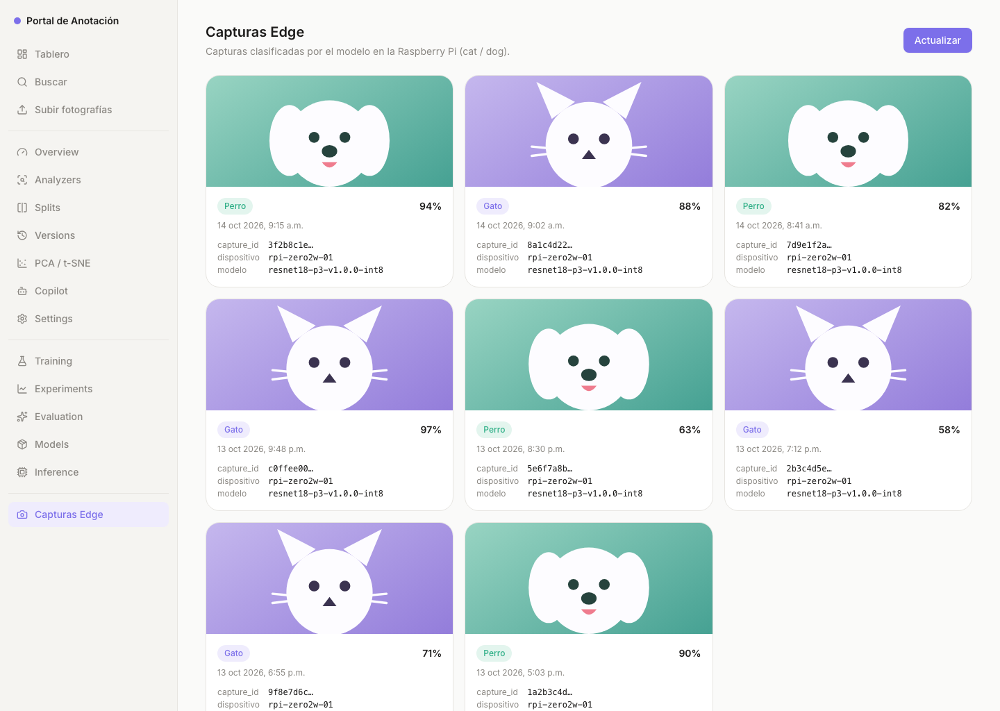

# P4-14 — Sección «Capturas Edge» en el portal

**Issue:** [#14](https://github.com/sanchezesteban/MLOPS_p4/issues/14) · **Responsable:** Uriel (@urielpinag)
**Ámbito:** rúbrica 5.1, 5.2, 5.3.

## Qué se agregó

Una sección **«Capturas Edge»** dentro del portal existente (no una página aislada): entrada propia en el menú global (`/captures`) y una rejilla de tarjetas con las capturas clasificadas por el modelo en la Raspberry Pi.

Cada tarjeta muestra **foto, clase (`cat`/`dog`), confianza, fecha, `capture_id`, dispositivo y versión del modelo** — exactamente los campos del contrato del evento v1 (`docs/p4/contrato-evento.md`).

- **Orden:** de la más reciente a la más antigua (por `captured_at`).
- **«Actualizar»:** vuelve a pedir los datos (`reload`).
- **Estados:** esqueletos durante la carga, mensaje de lista vacía y estado de error con reintento.

## Datos de ejemplo

Mientras no exista la API de lectura (#15), el portal sirve `frontend/public/captures/sample.json`, que respeta el contrato v1 (clases, `model_version`, `model_sha256`, `crop`, etc.). Las imágenes son dos ilustraciones SVG de ejemplo (assets de UI, no datos del dataset).

La URL es configurable con `VITE_CAPTURES_API_URL`; **#15** la apunta a la API real y no hay que tocar la página.

## Evidencia

## Verificación

- `npm run lint`, `npm run typecheck`, `npm test` (188 pruebas, 5 nuevas) y `npm run build` → OK.
